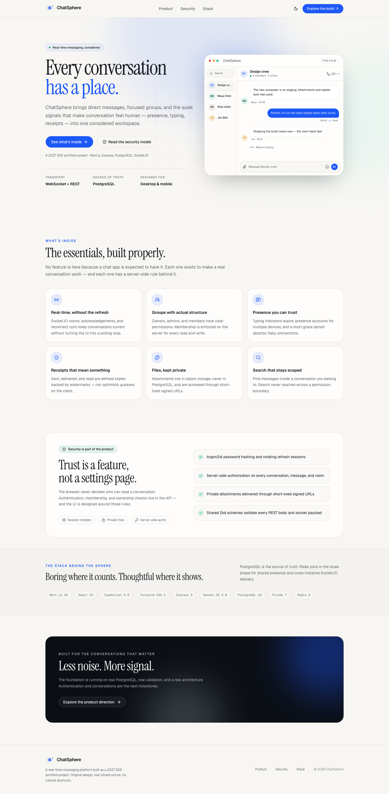
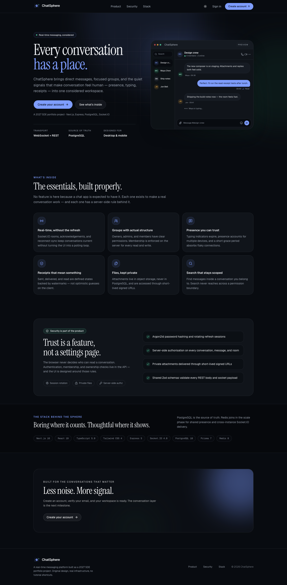
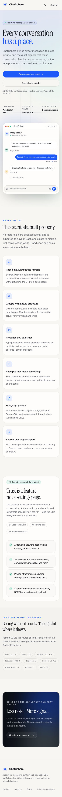
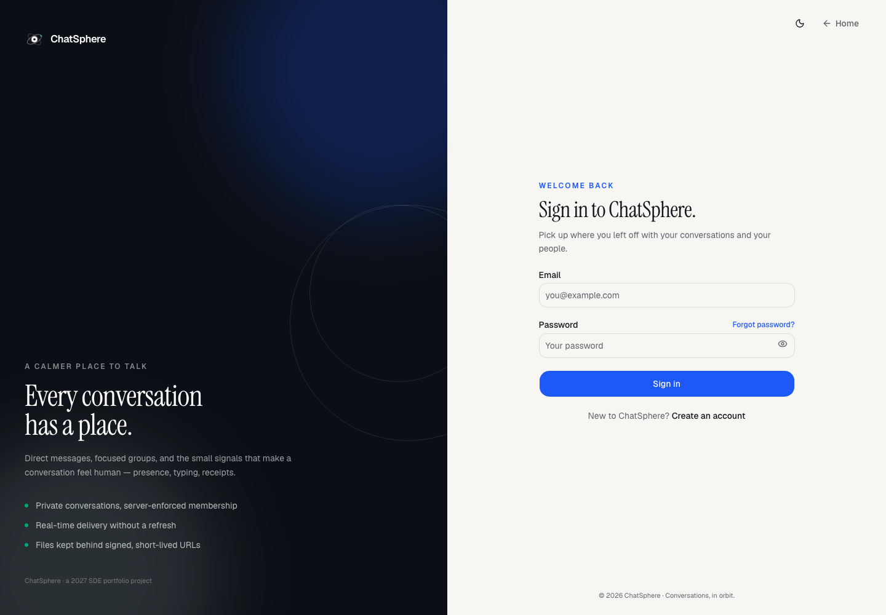
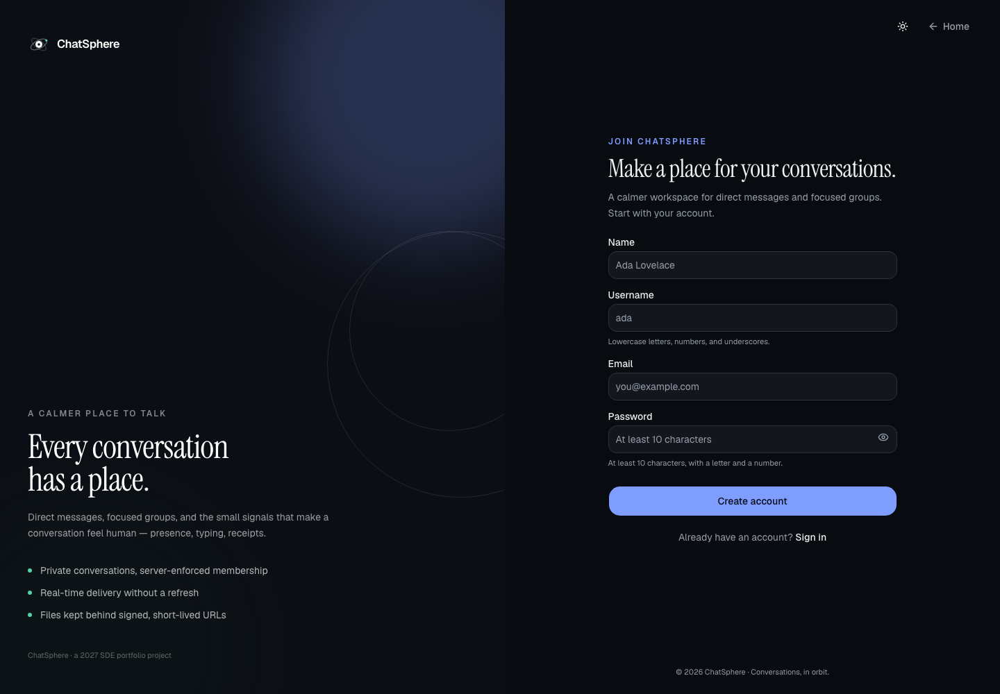
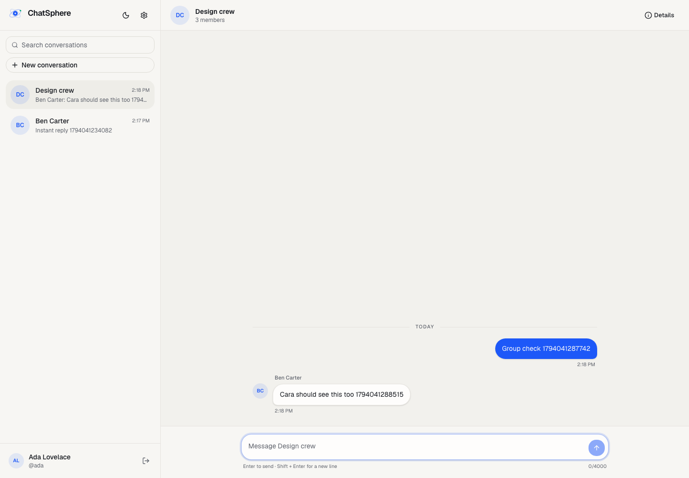
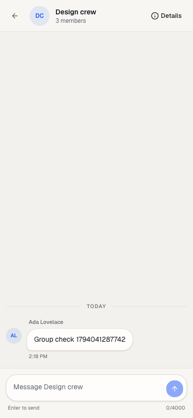
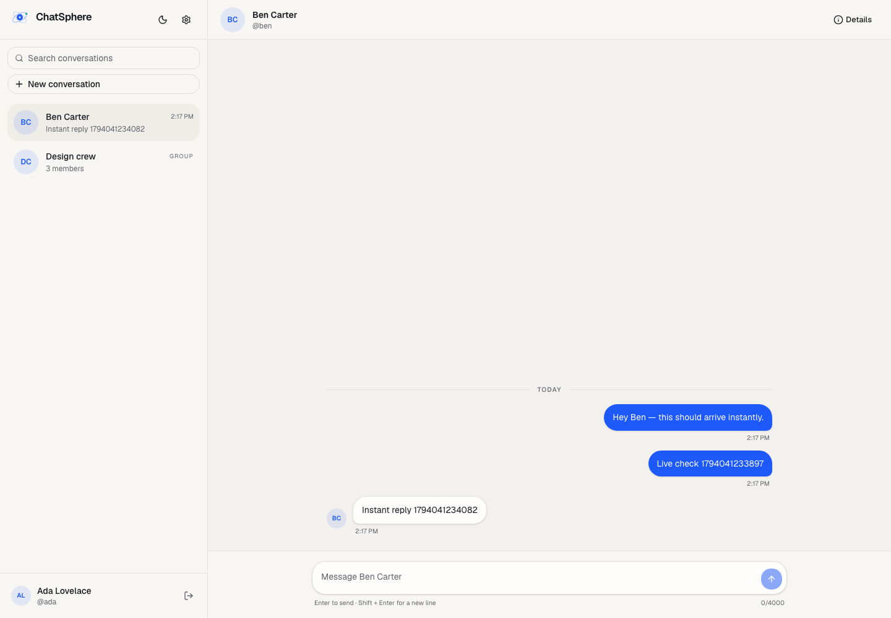
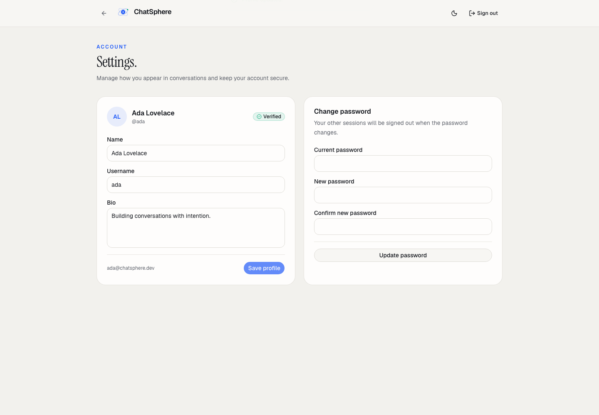

# ChatSphere

**ChatSphere** is a real-time messaging platform for direct conversations, focused group chats,
and the small signals that make conversation feel human: presence, typing, delivery and read
receipts.

This is a portfolio project built as a production-style modular monolith — not a tutorial chat
app. It is being built in verified milestones, with the architecture and trade-offs documented as
it grows.

> **Status: Phase 5 — real-time messaging.** Authenticated Socket.IO delivery, persisted messages,
> cursor-based history, optimistic sending, deduplication, and reconnect sync are implemented and
> verified. Typing, presence, receipts, attachments, and notifications are next. See the
> [Phase 5 verification log](docs/phase-5-messaging.md) for the commands and actual results.

## What works today

- Original responsive landing page with light/dark themes and an accessible design system.
- **Authentication:** Argon2id password hashing, short-lived JWT access tokens, rotating refresh
  sessions with reuse detection, email verification, password reset, rate limits, and protected
  routes.
- **Users and profiles:** verified-user search, public profile cards, profile editing, and password
  changes that revoke other sessions.
- **Conversations:** direct chats enforced as one pair with a unique `directKey`; groups with owner,
  admin, and member roles; add/remove members; ownership transfer; per-user hide for direct chats;
  owner-only group deletion.
- **Messaging:** authenticated Socket.IO connections, persisted sends with acknowledgements,
  client-generated idempotency keys, optimistic message bubbles with retry, realtime conversation
  previews, infinite-scroll history, and reconnect catch-up.
- **Workspace UI:** responsive conversation list, message thread and composer, new-conversation flow
  (direct and group), group details and permission-aware controls, settings, and empty states.
- Express 5 API with validated environment, structured logging, CORS, Helmet, request IDs,
  consistent JSON envelopes, and liveness/readiness checks.
- PostgreSQL 18 schema managed by Prisma 7, including users, sessions, verification tokens,
  conversations, memberships, and the complete future messaging model.
- Docker Compose for PostgreSQL, Redis, Mailpit, and an S3-compatible local store (S3Mock).
- **Tests:** 42 Vitest unit, integration, and realtime tests and a Playwright authentication E2E
  test.
- GitHub Actions CI for install, Prisma generation, migrations, linting, type checking, tests, and
  builds. Playwright E2E is local-only for now.

## Not built yet

Typing indicators, presence, delivery/read receipts, message editing/deletion, attachments and
avatar uploads, notifications, the Redis Socket.IO adapter, Docker production images, and
deployment. These arrive in later phases, each with its own tests.

## Screenshots

<p>
  
  
</p>
<p align="center">
  
</p>

<p>
  
  
</p>
<p>
  
  
</p>
<p>
  
  
</p>

## Stack

| Layer       | Choice                                                                                                  |
| ----------- | ------------------------------------------------------------------------------------------------------- |
| Web         | Next.js 16.4.5 (App Router), React 19.3.1, TypeScript 5.9.3, Tailwind CSS 4.3.4, shadcn/ui, next-themes |
| API         | Node.js 24, Express 5.3.0, TypeScript, Zod 4, pino, Helmet, express-rate-limit                          |
| Auth        | Argon2id (`@node-rs/argon2`), `jose` JWT access tokens, rotating refresh sessions                       |
| Data        | PostgreSQL 18.6, Prisma 7.10.1 with `@prisma/adapter-pg`                                                |
| Realtime    | Socket.IO 4.8.4 (server) + socket.io-client 4.8.4                                                       |
| Local infra | Docker Compose, Redis 8.10, Mailpit, Adobe S3Mock                                                       |
| Testing     | Vitest 5, Supertest, Playwright 1.64                                                                    |
| Tooling     | pnpm 12.16.1, Biome 2.6.5, GitHub Actions                                                               |

Exact versions and the reasons for the important pins are in
[docs/decisions/001-toolchain.md](docs/decisions/001-toolchain.md).

## Architecture

```text
Browser (Next.js) ── REST ─────► Express API ── Prisma ──► PostgreSQL
        │                            │
        └──────── Socket.IO ─────────┘
                                     ├── Redis (scale phase: adapter, presence, rate limits)
                                     ├── S3-compatible object storage (attachments)
                                     └── SMTP / Mailpit (verification and reset email)
```

The browser keeps the access token in memory and the refresh token in an HttpOnly cookie. The API is
the only authority on authentication and authorisation. PostgreSQL is the source of truth for users,
conversations, messages, and receipts. Redis is introduced only when the core messaging workflow
works and multi-instance delivery requires it.

## Authentication design

- Passwords are hashed with **Argon2id** using OWASP-recommended interactive parameters.
- Access tokens are **15-minute HS256 JWTs**, held only in memory (Zustand), never in `localStorage`.
- Refresh tokens are **30-day opaque secrets**, stored only as SHA-256 hashes in `RefreshSession`.
  Every refresh rotates the token; reuse revokes the entire session family.
- The refresh cookie is `HttpOnly`, `SameSite=Lax`, `Secure` in production, and scoped to
  `/api/auth`.
- Email addresses and usernames are stored lowercase. Verification and reset tokens are hashed,
  single-use, and expiring.
- Auth endpoints are rate-limited. Cookie-authenticated refresh/logout requests also check the
  `Origin` header.
- The browser serialises refresh calls with the Web Locks API to avoid multi-tab rotation races.
- Unverified users can sign in but are redirected to `/verify-email` and cannot reach the app shell.

See [docs/phase-3-authentication.md](docs/phase-3-authentication.md) for the endpoint list and the
verified scenarios.

## Repository layout

```text
chatsphere/
├── apps/
│   ├── api/                 Express API, auth modules, Prisma schema/migrations, Vitest tests
│   └── web/                 Next.js App Router frontend, Playwright E2E test
├── packages/shared/         Shared Zod schemas, DTOs, and API types
├── docs/                    Decisions, phase logs, screenshots, operational notes
├── docker-compose.yml       Local Postgres, Redis, Mailpit, S3Mock
├── biome.json               Lint + format configuration
└── pnpm-workspace.yaml      Workspace and native build allow-list
```

## Local setup

### Prerequisites

- Node.js 24+
- pnpm 12 via Corepack
- Docker with Compose. On this Mac, the setup uses [Colima](https://colima.run) instead of Docker
  Desktop.

```bash
brew install colima docker docker-compose
colima start --cpu 4 --memory 6 --disk 40 --vm-type vz
```

If `docker compose` is not found, expose Homebrew's compose plugin:

```bash
mkdir -p ~/.docker/cli-plugins
ln -sf "$(brew --prefix)/bin/docker-compose" ~/.docker/cli-plugins/docker-compose
```

### First run

From the repository root:

```bash
cp .env.example .env
cp apps/api/.env.example apps/api/.env
cp apps/web/.env.example apps/web/.env.local

corepack enable --install-directory "$HOME/.local/bin" pnpm
corepack prepare pnpm@12.16.1 --activate

pnpm install
docker compose up -d
pnpm db:generate
pnpm db:migrate
pnpm dev
```

Replace `JWT_ACCESS_SECRET` in `apps/api/.env` with a random value before using the stack outside
local development. The verification and reset emails are delivered to Mailpit locally.

Open:

- Web: <http://localhost:3000>
- API health: <http://localhost:4000/api/health>
- API readiness (checks PostgreSQL): <http://localhost:4000/api/health/ready>
- Mailpit inbox: <http://localhost:8025>
- S3Mock endpoint: <http://localhost:9090>

### Local services

| Service           | Port        | Purpose                                       |
| ----------------- | ----------- | --------------------------------------------- |
| Web (Next.js)     | 3000        | Frontend                                      |
| API (Express)     | 4000        | REST API and authenticated Socket.IO endpoint |
| PostgreSQL        | 5432        | Persistent application data                   |
| Redis             | 6379        | Reserved for the scaling phase                |
| Mailpit SMTP / UI | 1025 / 8025 | Local email capture                           |
| S3Mock            | 9090        | Local S3-compatible object storage            |

## Common commands

| Command            | What it does                                                   |
| ------------------ | -------------------------------------------------------------- |
| `pnpm dev`         | Build shared contracts, then run API, web, and shared watchers |
| `pnpm build`       | Build shared, API, and web                                     |
| `pnpm lint`        | Biome check (lint, format, imports)                            |
| `pnpm format`      | Apply Biome safe fixes                                         |
| `pnpm typecheck`   | Build shared contracts, then typecheck every package           |
| `pnpm test`        | Run Vitest unit and integration tests                          |
| `pnpm test:e2e`    | Run Playwright E2E against running dev servers                 |
| `pnpm db:generate` | Generate the Prisma client                                     |
| `pnpm db:migrate`  | Create/apply a development migration                           |
| `pnpm db:deploy`   | Apply committed migrations (CI/production)                     |
| `pnpm db:studio`   | Open Prisma Studio                                             |
| `pnpm infra:up`    | Start local infrastructure                                     |
| `pnpm infra:down`  | Stop local infrastructure                                      |

## Testing

```bash
pnpm test       # 42 Vitest tests: unit, auth, users, conversations, and sockets
pnpm test:e2e   # Playwright: register → verify → sign in → sign out
```

`pnpm test` creates and migrates `chatsphere_test` automatically. Override the database with
`TEST_DATABASE_URL` if your local credentials differ. The test mailer is mocked, so integration tests
do not require Mailpit.

Playwright runs against the running dev stack. Before running it:

```bash
pnpm dev                                            # in one terminal
pnpm --filter @chatsphere/web exec playwright install chromium
```

The E2E test reads the real verification email through the Mailpit API, so Mailpit must be running.
It is not yet wired into GitHub Actions; the CI job runs the 42 Vitest tests. The two-browser
messaging flow is verified manually; the Socket.IO transport and delivery rules are covered by the
realtime suite.

## Technical decisions

- **Prisma 7.10.1 is pinned deliberately.** The npm `latest` tag currently points at an 8.0 release
  candidate; both the CLI and client stay on the stable 7 line.
- **TypeScript 5.9.3 is pinned.** The new TypeScript 7 compiler is not yet the safe default for this
  Next/Prisma/tooling combination; upgrade after a dedicated compatibility check.
- **Biome replaces ESLint + Prettier.** ESLint 10 is incompatible with the plugins loaded by
  `eslint-config-next` 16.4.5, while ESLint 9 is now formally deprecated. Biome provides linting,
  formatting, import organization, and accessibility rules in one supported tool.
- **S3Mock replaces MinIO locally.** The official MinIO Docker image is no longer publicly
  distributed. S3Mock is a local S3 API emulator; production will use S3 or Cloudflare R2. See
  [docs/decisions/002-local-object-storage.md](docs/decisions/002-local-object-storage.md).
- **Direct conversations are protected by a unique `directKey`**, and group ownership by a partial
  unique index. These are enforced in PostgreSQL, not only in application code.
- **Messages are fanned out to user rooms, not stale conversation rooms.** Every send resolves the
  current member list, so a removed member stops receiving messages immediately even if their socket
  is still open. Authorized conversation rooms are still joined for the upcoming typing and read
  features.
- **Client-generated message IDs make sends idempotent.** A unique `(senderId, clientMessageId)`
  constraint plus an ack/retry path prevents duplicate messages after reconnects or timeouts.
- **History uses a `(createdAt, id)` cursor.** Pages remain stable while new messages arrive, and
  `before` / `after` cursors support both older-page loading and catch-up.
- **Conversation access is checked at the service layer.** Non-members receive `404`, not `403`, so
  conversation existence is not leaked. Group role rules are enforced on every mutation, never in
  the browser.
- **Groups are capped at 50 members.** Ownership is unique at the database level; transferring it
  demotes the existing owner and promotes the target in one transaction.
- **Direct conversations are hidden per user, not deleted.** `ConversationMember.hiddenAt` keeps the
  other participant's history intact and starting the chat again reopens the same conversation.
- **Rate limits are in-memory for now.** They are correct for a single API instance; Redis-backed
  limits arrive with the scaling phase, before horizontal deployment is described as ready.

## Database

The initial migration creates: `User`, `Conversation`, `ConversationMember`, `Message`,
`MessageAttachment`, `MessageRead`, `MessageReaction`, `Notification`, `RefreshSession`, and
`VerificationToken`. A second migration adds database-level constraints for direct conversation
keys, group titles, one owner per conversation, and non-blank message content. A third migration
adds `pg_trgm` indexes for case-insensitive user search. Messages are ordered by `(createdAt, id)`
and deduplicated by `(senderId, clientMessageId)`.

```bash
pnpm db:migrate      # development
pnpm db:deploy       # CI / production
pnpm db:studio       # inspect data
```

## Roadmap

1. ~~Phase 1 — architecture plan~~ ✅
2. ~~Phase 2 — workspace, infrastructure, schema, API health, web shell, CI~~ ✅
3. ~~Phase 3 — authentication, verification, sessions, reset, protected routes, first tests~~ ✅
4. ~~Phase 4 — users, profiles, direct and group conversations~~ ✅
5. ~~Phase 5 — real-time messaging with Socket.IO~~ ✅
6. Phase 6 — typing, presence, receipts, attachments, notifications, message actions
7. Phase 7 — full realtime/E2E suites and failure hardening
8. Phase 8 — Redis, Docker production images, deployment, documentation, screenshots

## License

Portfolio project. Please ask before reusing the branding or content.
