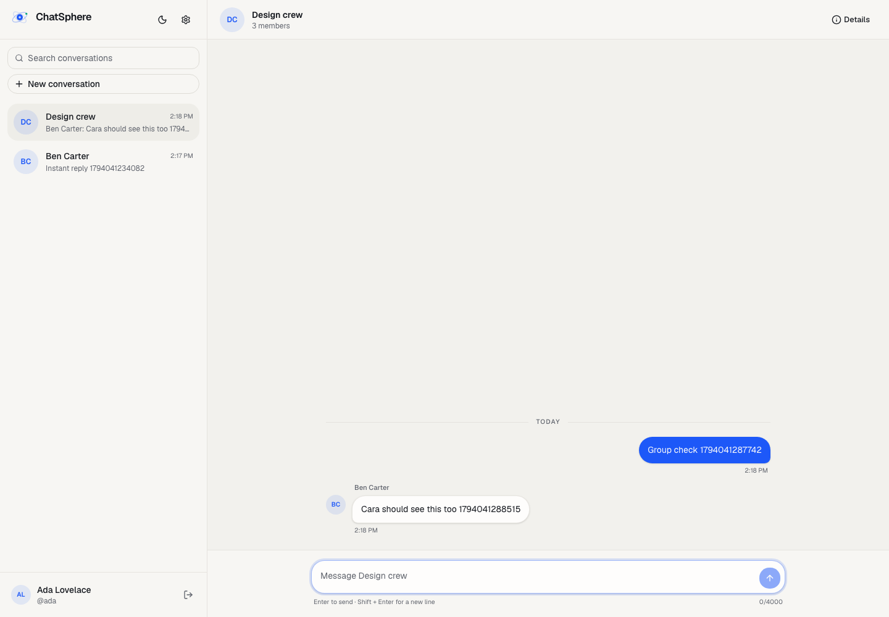
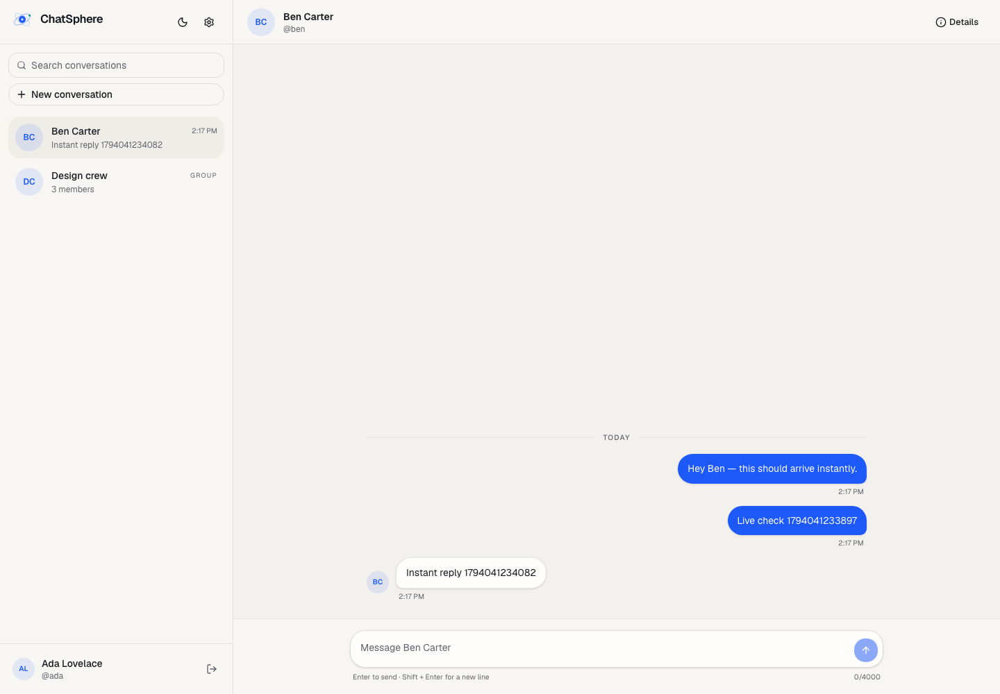
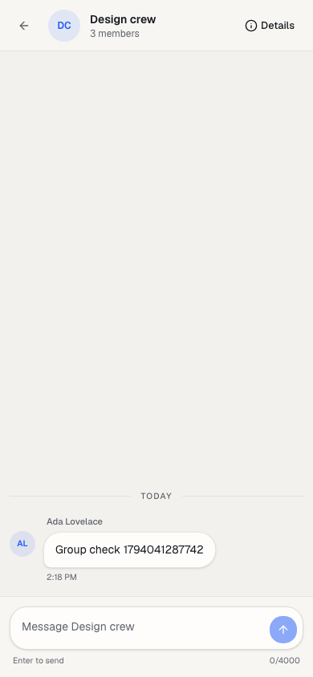

# Phase 5 — Real-time messaging verification

**Date:** 2026-11-07  
**Scope:** authenticated Socket.IO connections, message persistence, acknowledgements, duplicate
prevention, cursor history, optimistic UI, reconnect sync, and the conversation composer.

## Socket protocol

The Socket.IO server shares the Express HTTP server on port 4000.

| Event                  | Direction       | Purpose                                          |
| ---------------------- | --------------- | ------------------------------------------------ |
| `conversation:join`    | client → server | Join an authorized conversation room             |
| `conversation:leave`   | client → server | Leave the room                                   |
| `message:send`         | client → server | Persist a message and receive an acknowledgement |
| `message:new`          | server → client | Broadcast a persisted message to current members |
| `conversation:updated` | server → client | Update sidebar previews and ordering             |
| `auth:expired`         | server → client | Tell the client to refresh before reconnecting   |

Handshake authentication:

- Access token is read from `socket.handshake.auth.token`.
- JWT signature, issuer, audience, and expiry are verified.
- The refresh session referenced by `sid` must still exist and not be revoked.
- The user must exist and have a verified email.
- The socket joins a private `user:<id>` room and a `session:<id>` room.
- An expiry timer disconnects the socket when the access token expires; the client refreshes,
  replaces `socket.auth`, and reconnects.

Authorized conversation rooms are joined through `conversation:join`, which checks current
membership. Message fan-out deliberately uses the **current member user rooms** instead of the
conversation room: a removed member's open socket therefore stops receiving messages immediately.
This also keeps the fan-out correct if a socket missed a membership update.

## Message persistence and ordering

- `Message.clientMessageId` is generated on the client and unique per sender.
- `@@unique([senderId, clientMessageId])` makes retries idempotent.
- The message row and the conversation's `updatedAt` are written in one transaction.
- Duplicate sends return the original message with `duplicate: true` and do not rebroadcast.
- Ordering is `(createdAt, id)`, a stable tuple used by both the broadcast and cursor pagination.
- The server validates `content` through the shared Zod schema (1–4000 characters after trimming).
- Per-socket message rate limit: 20 messages per 10 seconds.

History endpoint:

```text
GET /api/conversations/:id/messages?limit=30
GET /api/conversations/:id/messages?before=<cursor>&limit=30
GET /api/conversations/:id/messages?after=<cursor>&limit=30
```

`limit` is capped at 50. Responses include `meta.hasMore`, `meta.oldestCursor`, and
`meta.newestCursor`. Non-members receive `404`; invalid cursors receive `400`.

## Client behavior

- `SocketProvider` owns one socket for the authenticated app and refreshes the session when the
  server reports an expired token.
- `MessageThread` joins the active conversation, loads older pages through an intersection observer,
  and keeps a "New messages" button when the reader is scrolled up.
- Sending inserts an optimistic bubble immediately. The server acknowledgement replaces it with the
  persisted message; a timeout leaves a failed bubble with **Retry** using the same
  `clientMessageId`.
- On socket reconnect, conversation and message queries are invalidated, so the client catches up
  from persisted server history. The API also supports incremental `after` catch-up; the current
  client uses a full refetch for simplicity.
- Sidebar previews and ordering update from `conversation:updated`, without a page refresh.

## Verification executed

```text
pnpm test
  9 files passed
  42 tests passed
    - auth: 13
    - users/profiles/password: 6
    - conversations/permissions: 5
    - message history/pagination: 4
    - realtime Socket.IO: 4
    - unit: 10
```

The realtime suite verifies:

- Valid token authentication and authorized room joins.
- Non-member join rejection.
- Realtime delivery of a persisted message to another member.
- Duplicate `clientMessageId` idempotency with no second broadcast.
- Persistence and history API visibility.
- Reconnect and rejoin delivery.
- Invalid tokens and revoked refresh sessions are rejected.

Manual two-browser verification (Ada on desktop, Ben on mobile):

- Direct conversation message reception in both directions.
- Group conversation reception with sender names.
- Sidebar preview updates while the recipient was on the conversation list.
- Messages still present after a page reload.
- No browser page errors or console errors.

Other checks:

- `pnpm lint` — passed, 153 files.
- `pnpm typecheck` — passed for shared, API, and web.
- `pnpm build` — passed; 11 routes, including the dynamic conversation route.
- `pnpm test:e2e` — existing authentication E2E passed (1 test).

Screenshots:







## Known limitations / deferred work

- No delivered/read receipts, typing indicators, or presence yet.
- No message editing, deletion, reactions, replies, attachments, or avatar uploads yet.
- Conversation membership changes are not pushed live; affected users see them on the next fetch.
- Reconnect catch-up refetches history rather than issuing an incremental `after` request, even
  though the endpoint supports it.
- The rate limit is per socket, not per user, and is in-memory.
- There is no Redis Socket.IO adapter yet; the API should run as one instance until that lands.
- Logout disconnects the local socket, but an access token can remain valid for up to 15 minutes.
  This matches the REST token model and is documented as a hardening item.
- The two-browser messaging flow is manual; Playwright currently covers authentication only.

## Next

Phase 6 adds typing indicators, presence, delivered/read receipts, message actions
(edit/delete/reactions/replies), attachments, and notifications.
