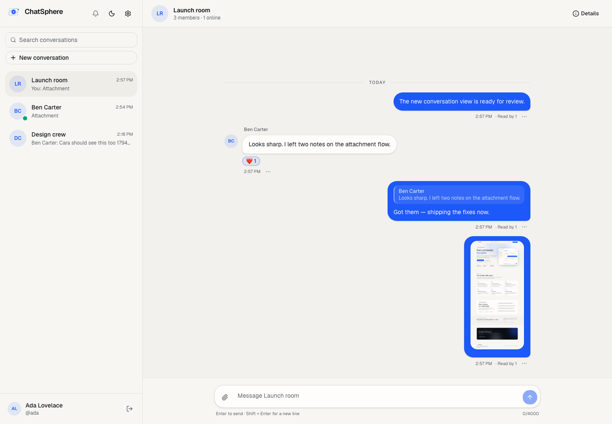
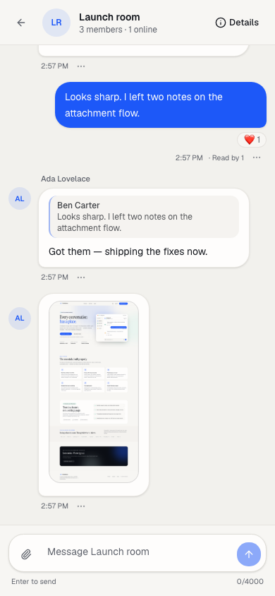

# Phase 6 — Realtime collaboration verification

**Date:** 2026-11-07  
**Scope:** typing, presence, delivery/read receipts, message editing/deletion, reactions, replies,
S3-backed attachments, and in-app notifications.

## Realtime events

| Event                                | Direction             | Purpose                                      |
| ------------------------------------ | --------------------- | -------------------------------------------- |
| `typing:start` / `typing:stop`       | client → server       | Ephemeral typing activity                    |
| `typing:updated`                     | server → conversation | Show/hide a member's typing state            |
| `presence:snapshot`                  | server → client       | Initial co-member presence                   |
| `presence:updated`                   | server → co-members   | Member came online or went offline           |
| `message:delivered` / `message:read` | client → server       | Persist delivery/read position               |
| `receipt:updated`                    | server → members      | Refresh receipt labels and member timestamps |
| `message:new`                        | server → members      | New persisted message                        |
| `message:updated`                    | server → members      | Edited, deleted, or reacted message          |
| `notification:new`                   | server → user         | New in-app notification                      |
| `auth:expired`                       | server → client       | Refresh before reconnecting                  |

Presence is tracked in-memory per user socket set. Updates are emitted only to users who share a
conversation, using their private user rooms. This is a single-instance implementation; Redis-backed
presence and the Socket.IO adapter belong to the scaling phase.

Typing events are rate-limited per socket and emitted only to the authorized conversation room. The
client expires a typing indicator after four seconds if no stop event arrives.

## Receipts

- `ConversationMember.lastDeliveredAt` and `lastReadAt` are the source of truth for receipt labels.
- A read event also writes the latest read message to `MessageRead`.
- Direct messages show **Sent → Delivered → Read**.
- Group messages show **Sent → Delivered to N → Read by N / Read by all**.
- The client marks delivery when a message arrives in the open conversation and marks read when the
  thread is at the bottom and the window is focused.
- A read receipt updates `lastDeliveredAt` as well, so an interrupted delivery/read sequence cannot
  leave an unread message marked delivered.

## Message actions and permissions

| Action              | Who                                                               |
| ------------------- | ----------------------------------------------------------------- |
| Edit own message    | Sender only, while not deleted                                    |
| Delete message      | Sender, or group owner/admin                                      |
| Add/remove reaction | Any current conversation member, one emoji per user/message       |
| Reply               | Any current member; reply target must be in the same conversation |

REST endpoints:

```text
PATCH  /api/messages/:id
DELETE /api/messages/:id
POST   /api/messages/:id/reactions
DELETE /api/messages/:id/reactions/:emoji
```

All actions broadcast `message:updated` to current member user rooms. Edits and deletes also refresh
the conversation preview via `conversation:updated`. Deletes are soft deletes: content and
attachment display disappear, and the row remains for reply integrity.

## Attachments

- `POST /api/attachments` accepts `multipart/form-data` with one `file` field.
- Allowed types: JPEG, PNG, WebP, GIF, PDF, and plain text.
- Limit: 10 MB per file, five attachments per message.
- Files are stored through the AWS SDK v3 in the S3-compatible bucket (`chatsphere-attachments`).
- An attachment row is created as unattached; the sender claims it inside the message transaction.
- Attachment ownership and unattached state are checked before claiming.
- Downloads use presigned GET URLs with a one-hour default TTL.
- The UI shows image previews and file cards, uploads before sending, and removes them from the
  composer.

Local S3Mock exposes the initial buckets. Production uses S3 or Cloudflare R2 through the same
adapter.

## Notifications

- Message sends create a persisted `MESSAGE` notification for every recipient except the sender.
- Group add/remove/role changes create `GROUP_ADDED`, `GROUP_REMOVED`, and `GROUP_ROLE_CHANGED`
  notifications.
- Notifications include a small typed payload (actor, conversation title, preview, message id, role).
- They are pushed over `notification:new` and refreshed through the notification center.
- The sidebar bell shows the unread count.
- Opening a conversation or a notification marks the relevant notifications read.
- `GET /api/notifications` returns the latest 50 notifications plus an unread count.
- `POST /api/notifications/read` marks one conversation (or all).
- `POST /api/notifications/:id/read` marks one notification.

## UI additions

- Typing indicator above the composer.
- Online dots in conversation lists, headers, and group member rows; group header online count.
- Read/delivered labels under own messages.
- Hover/tap message action menu with quick reactions, reply, edit, and delete.
- Reaction chips that toggle the current user's reaction.
- Reply composer preview and quoted reply inside message bubbles.
- Inline edit form inside the message bubble.
- Notification center dialog with unread state and mark-all-read.
- Attachment picker, upload chips, image previews, and file cards.

## Verification executed

```text
pnpm test
  12 files passed
  52 tests passed
    - auth: 13
    - users/profiles/password: 6
    - conversations/permissions: 5
    - message history/pagination: 4
    - message actions: 4
    - realtime messaging: 4
    - presence/typing/receipts/notifications: 4
    - attachment upload/claiming: 2
    - unit: 10
```

Coverage added this phase:

- Edit/delete permission checks, moderator deletion, reaction upsert/removal, reply previews.
- Attachment allowlist, upload row, ownership, message claiming, and empty-content attachment sends.
- Typing start/stop delivery, online/offline presence, delivery/read receipt persistence, message
  notifications, notification marking, replies, and attachment DTOs.

Manual browser verification (Ada desktop and Ben mobile, with Cara in the group):

- Online indicator and green presence dots.
- Typing indicator appears for the other member.
- Read receipt appears on the sender's message.
- Reactions propagate in both directions.
- Reply preview and quoted message render correctly.
- Inline edit propagates.
- Delete changes the bubble to "Message deleted" for both clients.
- Image attachment uploads through S3Mock, renders in both clients, and scrolls fully into view.
- Notification bell unread badge, notification dialog, and notification navigation.
- No browser page errors or console errors.

Other checks:

- `pnpm lint` — passed, 176 files.
- `pnpm typecheck` — passed for shared, API, and web.
- `pnpm build` — passed; 11 routes.
- `pnpm test:e2e` — existing authentication E2E passed (1 test).

Screenshots:





## Known limitations / deferred work

- Presence and notification badge fan-out are in-memory/single-instance; no Redis adapter yet.
- Typing state is ephemeral and not persisted; a lost stop event clears after four seconds.
- Read receipts are coarse (per-member latest position); the per-message `MessageRead` table only
  stores the latest read message.
- Attachment uploads have no malware scanning, thumbnail generation, or orphan cleanup yet.
  Presigned URLs expire after one hour.
- Deleted messages retain their attachment objects in S3 until cleanup work lands.
- Notifications are in-app only; there is no email or push channel.
- No message search, moderation audit log, or per-message read list.
- The realtime UI flows are verified manually; Playwright currently covers authentication only.
- Docker production images and deployment remain for a later phase.

## Next

Phase 7 focuses on final realtime/E2E coverage, failure hardening, accessibility polish, and
edge-case tests. Phase 8 adds Redis, production Docker images, and deployment.
