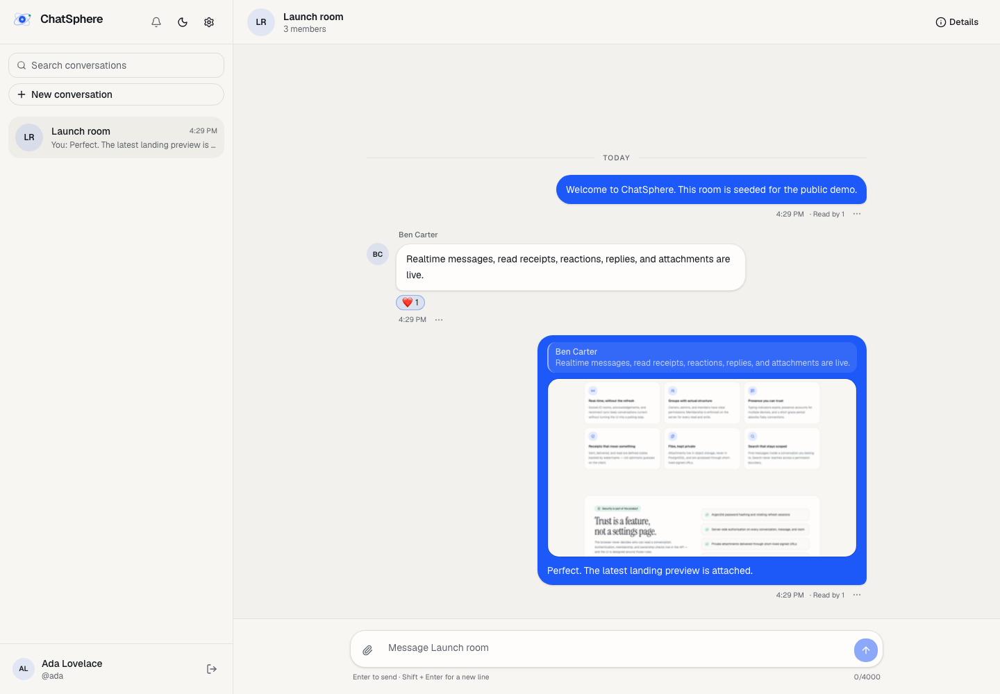

# Temporary public demo via Cloudflare Quick Tunnel

This is a **temporary demo**, not a production deployment. It exposes the local production Compose
stack through two account-less Cloudflare Quick Tunnels:

- `https://<random>.trycloudflare.com` → Nginx (`localhost:8080`)
- `https://<random>.trycloudflare.com` → S3Mock (`localhost:9090`) for attachment URLs

The tunnel stays online only while this machine, the production Compose stack, and both
`cloudflared` processes are running. The hostname changes if the tunnel is restarted.

## Prerequisites

- Production images built.
- Production Compose stack running.
- Cloudflare `cloudflared` installed.
- Mailpit running for demo-account verification; Mailpit is **not** exposed publicly.
- A local S3Mock bucket for attachments.

## Start

```bash
# Terminal 1: public app
cloudflared tunnel --url http://localhost:8080 --no-autoupdate --protocol http2

# Terminal 2: public attachment storage
cloudflared tunnel --url http://localhost:9090 --no-autoupdate --protocol http2
```

Take the two generated `https://*.trycloudflare.com` URLs and update `.env.production`:

```dotenv
PUBLIC_ORIGIN=https://<app-tunnel>.trycloudflare.com
COOKIE_SECURE=true
S3_ENDPOINT=https://<s3-tunnel>.trycloudflare.com
S3_FORCE_PATH_STYLE=true
```

Recreate the API so `WEB_ORIGIN`, secure cookies, email links, and attachment presigning use the
public hosts:

```bash
docker compose --env-file .env.production -f docker-compose.prod.yml up -d --force-recreate api
```

Verify:

```bash
curl https://<app-tunnel>.trycloudflare.com/api/health/ready
curl -I https://<app-tunnel>.trycloudflare.com/
```

## Demo accounts

The demo workspace is seeded with three verified accounts and the **Launch room** group, including
messages, a reaction, a reply, read receipts, and an image attachment.

Demo credentials are handed off privately rather than committed to the repository. Do not expose the
Mailpit inbox or reuse these credentials outside the temporary demo.



New registrations cannot complete email verification in this tunnel-only setup: Mailpit is local and
intentionally not public. Configure a real SMTP provider (Brevo, SMTP2GO, Resend with a domain,
etc.) before inviting self-service signups.

## Verification performed

- Public auth + accessibility Playwright test passed against the tunnel origin.
- Full two-user realtime Playwright test passed through the tunnel:
  typing, delivery, read receipts, reactions, replies, edit, delete, attachment upload,
  notifications, and navigation.
- Public readiness returned `database=up`, `redis=up`.
- The public demo account signed in, opened **Launch room**, and loaded the presigned S3 image.

## Stop

Stop the two `cloudflared` processes. The public URLs stop working immediately. The local stack and
data remain.

## Limits

- No uptime guarantee and no stable hostname.
- `COOKIE_SECURE=true` because Cloudflare terminates TLS; do not switch back to HTTP while using the
  public URL.
- Local PostgreSQL/Redis volumes and the local S3Mock are not managed production services.
- S3Mock is publicly reachable through the attachment tunnel; use managed S3/R2 for anything beyond a
  temporary demo.
- Registration email verification is not public. Use the seeded demo accounts or configure SMTP.
- Not a substitute for a permanent Fly/VPS deployment with managed services and backups.
